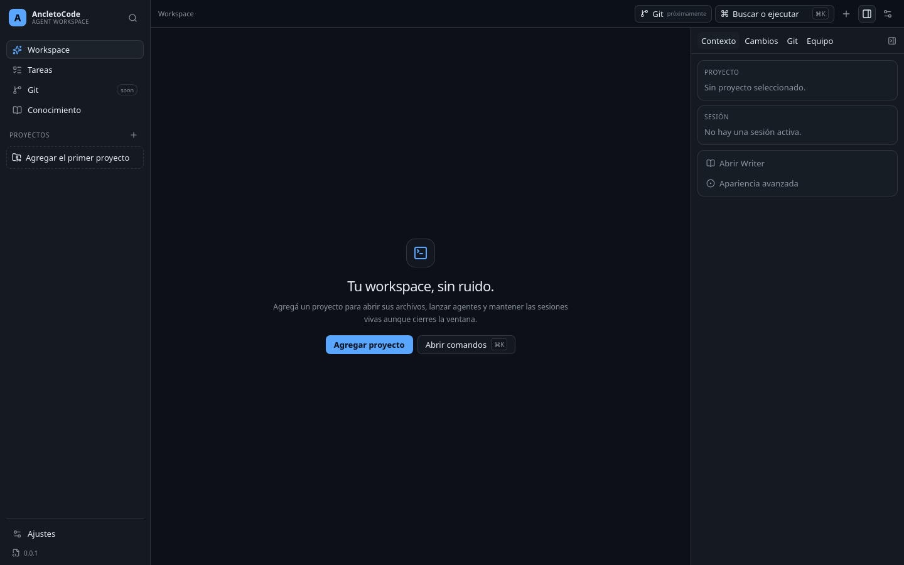
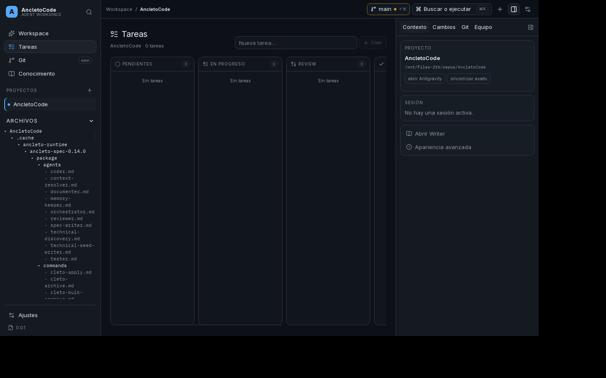
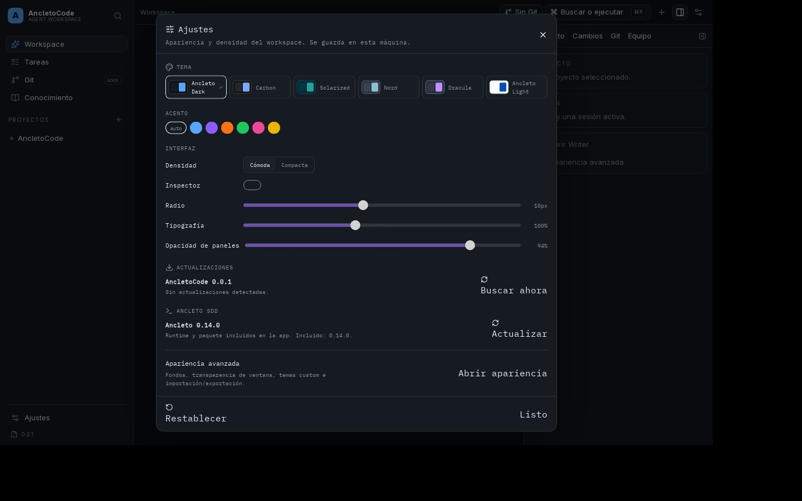

# AncletoCode

[](https://github.com/AncletoCEO/AncletoCode/actions/workflows/ci.yml)
[](https://github.com/AncletoCEO/AncletoCode/releases)
[](LICENSE)
[](https://www.rust-lang.org/)
[](https://tauri.app/)
[](#instalación)

Workspace de agentes de código para escritorio: proyectos, sesiones persistentes,
tareas con worktrees, Git y Ancleto SDD en una sola app local-first.

> **Estado:** `0.0.4`, release interno/beta desktop-only. Windows todavía no está
> validado manualmente por maintainers. AncletoCMD, CLI `acode`, npm y AUR están
> fuera de alcance por ahora.



## Qué incluye

- **UI híbrida:** shell de tres columnas, tabs/threads, inspector,
  command palette y temas configurables.
- **Sesiones PTY persistentes:** cerrar la ventana hace *detach*, no mata al agente.
- **Tareas y worktrees:** board por proyecto; iniciar una tarea crea su rama
  `task/...` y un worktree aislado.
- **Git local:** status, ramas, diff, staging, commit, fetch, pull, push, merge y
  worktrees.
- **GitHub:** remoto, PRs e issues vía `gh`. GitLab queda diferido.
- **Ancleto SDD embebido:** Node, `@ancleto/spec` y `@ancleto/writer` incluidos;
  actualización de spec administrada desde Ajustes con verificación de integridad
  y rollback. `@ancleto/writer-languages` sigue siendo un pack nativo opcional.
- **Updates de la app:** chequeo al iniciar y aviso de nueva versión.
- **Uso de proveedores:** panel inspirado en Orca; OpenCode reporta tokens/costo
  local y Antigravity cuotas reales vía `agy -p /usage`. Claude y Command Code
  muestran estados explícitos, sin cuotas inventadas.

## Capturas

| Tareas y worktrees | Ajustes y Ancleto embebido |
|---|---|
|  |  |

## Instalación

Artefactos en [Releases](https://github.com/AncletoCEO/AncletoCode/releases/tag/v0.0.4).
Verificá siempre `SHA256SUMS`.

### Linux

```bash
# Debian/Ubuntu
sudo apt install ./AncletoCode_0.0.4_amd64.deb

# Arch/EndeavourOS y otras distros
chmod +x AncletoCode_0.0.4_amd64.AppImage
./AncletoCode_0.0.4_amd64.AppImage

# Si FUSE no está disponible
./AncletoCode_0.0.4_amd64.AppImage --appimage-extract-and-run
```

Requisitos: WebKitGTK 4.1, GTK 3, libsoup 3 y librsvg.

### Windows 10/11 x64

Usá `AncletoCode_0.0.4_x64-setup.exe` (NSIS) o
`AncletoCode_0.0.4_x64_en-US.msi`. También hay ZIP portable:

```powershell
Expand-Archive .\AncletoCode-0.0.4-windows-x64-portable.zip -DestinationPath .\AncletoCode
.\AncletoCode\ancleto-code-desktop.exe
```

Si SmartScreen advierte por ser una build interna sin firma, verificá el hash y
elegí **Más información → Ejecutar de todos modos**.

### macOS

Diferido; no hay artefactos en 0.0.2.

## Primeros pasos

1. Abrí **AncletoCode** y agregá un proyecto local.
2. Creá una sesión de agente y elegí el driver instalado.
3. Usá **Tareas** para planificar; **Iniciar** crea rama y worktree.
4. Revisá cambios, hacé commit y abrí PRs/issues desde el inspector Git.
5. Configurá Ancleto y sus actualizaciones en **Ajustes**.

Las CLIs de agente (`claude`, `opencode`, `agy`, `cmd`) se instalan y autentican
por separado. Ancleto no requiere que el usuario instale Node: viaja con la app.

## Arquitectura

```text
React 19 + Vite + Tailwind/Radix
              │
        Tauri 2 (Rust)
              │
   ┌──────────┴──────────┐
   │  ancleto-code-core  │
   │ PTY · Git · tasks   │
   │ providers · SQLite  │
   └──────────┬──────────┘
              │
   host de sesiones + drivers
```

- El frontend no ejecuta procesos ni accede directamente al filesystem.
- El core Rust concentra sesiones, Git, tareas y persistencia.
- El host local es dueño de los PTY y permite detach/attach.
- Ancleto SDD se ejecuta con un runtime Node incluido y un paquete administrado.

## Desarrollo

```bash
npm ci
npm run prepare:ancleto
npm run tauri dev
```

Verificación:

```bash
cargo fmt --all -- --check
cargo clippy --workspace --all-targets
cargo test --workspace
npm run lint
npm run typecheck
npm run test
npm run build
npm run license:check
```

Release desktop-only:

```bash
npm run tauri -- build --bundles deb,appimage   # Linux
npm run tauri -- build --bundles nsis,msi       # Windows
```

## Roadmap

El trabajo siguiente está en issues y en el change
[`aspec/changes/ancleto-code-desktop-0.0.3`](aspec/changes/ancleto-code-desktop-0.0.3/proposal.md):

- adapters de cuota para Claude, Antigravity, Command Code y OpenCode;
- review/checks/merge de PRs de GitHub;
- abrir proyectos desde worktrees y completar Task/Thread;
- actualización firmada con instalación desde la app;
- validación manual de Windows;
- hardening de actualización/rollback de Ancleto.

GitLab y otros hosts Git, AncletoCMD, CLI, npm, AUR y macOS quedan fuera de
alcance por ahora.

## Licencias y atribuciones

AncletoCode se distribuye bajo **AGPL-3.0-only**. Ver [`LICENSE`](LICENSE).

**This is a fork of PandaCode** — https://github.com/aicodeking/pandacode

AncletoCode reutiliza código de PandaCode bajo la PandaCode License (MIT con
requisito de atribución de fork). Los avisos completos están en
[`THIRD_PARTY_NOTICES.md`](THIRD_PARTY_NOTICES.md) y la procedencia en
[`docs/provenance.md`](docs/provenance.md).

La revisión técnica de compatibilidad está en
[`docs/compliance/license-review-0.0.1.md`](docs/compliance/license-review-0.0.1.md).
Para un release estable se recomienda revisión legal externa.

## Documentación

- [Sistema de diseño](docs/design/desktop-ui.md)
- [Plan de release](docs/release-plan.md)
- [Notas 0.0.4](docs/release-notes/0.0.4.md)
- [Propuesta vigente](aspec/changes/ancleto-code-desktop-workplace/proposal.md)
- [Tareas](aspec/changes/ancleto-code-desktop-workplace/tasks.md)

## Contribuir

El proyecto usa el flujo SDD de `@ancleto/spec`. Los cambios se proponen en
`aspec/changes/` y se implementan después de aprobar propuesta, diseño y tareas.
Al enviar una contribución aceptás que se distribuya bajo `AGPL-3.0-only`.
